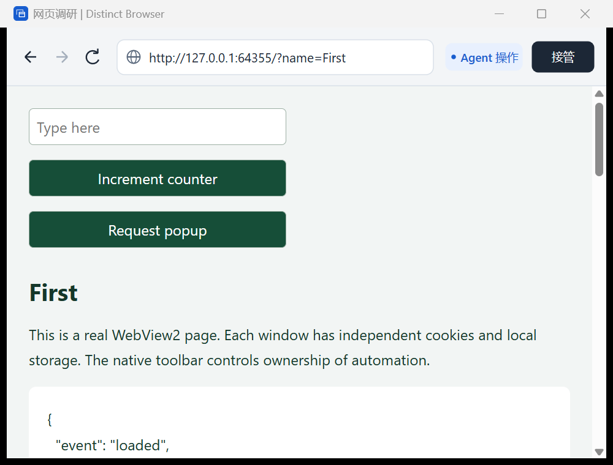

# Distinct Browser · v0.6.1 Account-isolated Session Recovery

一个 Windows 11 x64 原生浏览器宿主：C++17、Win32 窗口、系统 WebView2 Runtime。每个浏览器有真实窗口、独立数据目录和控制权状态。一个进程可以代表多个逻辑调用者，通过重定向的 stdin/stdout 发送 UTF-8 JSON 行。

v0.6.1 修复真实跨用户验收发现的账户隔离缺口：`CreateProcessWithLogonW` 的另一账户进程可能保留调用方的登录 SID，因此文件与管道 ACL 必须限定账户 SID，服务端再同时核对账户与登录 SID。修复后的真实普通账户用例已验证拒绝读取端点、拒绝连接管道、原页面保留与临时账户清理；物理键鼠、IME、触摸和跨屏 DPI 仍待独立验收。

v0.6 增加可选的存活宿主重连。`--reconnect` 使用本地命名管道；客户端退出后保留真实窗口、页面、输入和滚动状态。新连接验证宿主身份并读取快照，浏览器仍保持人工控制；交还后必须申请新令牌并重新观察。旧请求、旧输出与迟到回调按连接代次隔离，不重放动作。无参数仍为原有 stdin/stdout JSONL v1。只连接仍存活的原宿主，不恢复已经退出的宿主或崩溃前的业务工作。

v0.5 增加原生下载面板和网站权限提示。下载展示进度、保存路径、完成 / 中断原因，支持取消，`Ctrl+J` 可重新打开面板；文件不会自动打开或执行。权限提示显示请求来源和权限类型，由用户选择“允许一次”或“拒绝”，不提供自动授权 RPC，也不保存到 Profile。下载和权限等待会撤销整个浏览器的自动租约；处理结束后由用户交还，调用者必须申请新租约并重新观察。

v0.4 支持同一浏览器会话中的多个页面。网页的新窗口请求会创建受管理的原生窗口，保留来源页并共享所属会话的登录环境；每页有独立 `page_id`，租约仍属于浏览器。新增 `list_pages`、`select_page`、`close_page`，观察和动作可指定页面，切换后必须重新观察。继续兼容不指定页面的 JSONL v1 调用；首版不增加标签栏或新的 UI 框架。

交付文件是 `build/distinct-browser.exe`。静态链接 WebView2 Loader 和 MSVC CRT，无需旁带 Loader DLL、VC++ Redistributable 或 .NET；机器仍须安装支持宿主输入处理的 WebView2 Evergreen Runtime（138 或更高版本，创建时检查接口能力）。SDK 是构建依赖，Python 只用于演示和验收。

v0.2 使用 Direct2D / DirectWrite 绘制单行 64 DIP 原生工具栏，保留 Windows 原生地址编辑框。支持返回、前进、刷新 / 停止、地址输入、明暗主题与 DPI 缩放，控制状态和接管入口始终可见。页面、窗口和登录数据不会因为工具栏操作而重建，JSONL 协议仍为 v1。



v0.3 在原有外壳上增加原生输入仲裁：用户直接点击、输入、滚动或拖动网页时，先撤销该页自动令牌，再把同一次输入交给 WebView2；悬停、焦点变化和展示窗口不接管。已派发操作保留真实收尾，交还后取得新租约并重新观察。沿用 JSONL v1，`control_changed.detail.reason` 增加 `human_input`。

实现范围及消息测试、桌面测试与人工验收的区别见 [v0.3 说明](docs/v0.3.md)；原生外壳说明保留在 [v0.2](docs/v0.2.md)。v0.3.2 修复 UI 停顿后键盘接管失效，改用独立钩子线程和每浏览器原子撤权标记；真实设备、IME、触摸 / 笔和跨屏 DPI 仍待人工验收，入口见 [稳定性与人工验收](docs/v0.3-stability-validation.md)。

## 运行演示

```powershell
python demo/demo.py
```

演示在本地启动测试页面，打开 A、B 两个窗口，并行输入和点击；第二个调用者随后接管 A 的同一页面。窗口保持打开，可以体验原生“接管 / 交还”、地址栏导航、最小化和恢复。终端按 Enter 关闭演示窗口。

人机协作演示：`python demo/collaborate.py`。两个调用者持续操作各自的计数器；直接操作 A 后 A 停止、B 继续，点击“交还”后 A 用新租约观察再继续。`--typing` 模式让输入框保持焦点，便于手工验证键盘和 IME 介入。演示不注入系统键鼠。

EXE 通过管道启动，不分配控制台。双击 EXE 不会启动演示；其他语言的调用方可以直接启动 EXE 并连接管道，不需要 Python。

存活会话恢复演示（独立输出目录，避免覆盖正在使用的旧版 EXE）：

```powershell
./scripts/build.ps1 -OutputDirectory build/v06
python demo/recover.py --url https://example.com
# 退出客户端后，使用上一步打印的 Endpoint 原样重连：
python demo/recover.py --endpoint "<Endpoint 路径>"
```

重连后先在原生窗口点击“交还”，演示客户端才申请新租约并观察。保留 Endpoint 路径即可；不要复制或展示其中的受保护凭据。宿主已退出时客户端报错，不自动创建替代页面。访问边界与连接规则见[协议](docs/protocol.md#可选的存活宿主重连v061)。

## 构建

需要 MSVC x64 C++ 工具和 Windows SDK（含 C++/WinRT）。在 x64 Native Tools 命令环境启动 PowerShell 后运行：

```powershell
./scripts/build.ps1
```

脚本也会寻找 Visual Studio 或 `.tools/msvc/VC/Tools/MSVC` 中的编译器；可以指定 `-MsvcRoot`、`-WindowsSdkRoot`、`-OutputDirectory`。首次构建下载固定的 WebView2 SDK `1.0.3650.58` 到 `.deps`，校验 SHA-256 后解压，不安装系统组件。

也可在已配置的 MSVC 开发环境中使用 CMake（先用上述脚本取得 SDK）：

```powershell
cmake -S . -B build/cmake -A x64
cmake --build build/cmake --config Release
ctest --test-dir build/cmake -C Release --output-on-failure
```

## 验收

```powershell
./scripts/build.ps1
python tests/integration.py
python tests/pages.py
python tests/downloads.py
python tests/navigation.py
python tests/shell.py
python tests/collaboration.py
python tests/toolbar_component.py
python tests/protocol.py
python tests/recovery.py build/v06/distinct-browser.exe
python tests/failures.py
```

编译后也可用 `./scripts/test.ps1` 一次运行全部检查。

构建脚本运行控制权状态机测试，并编译原生工具栏组件测试宿主。集成检查启动真实 EXE 和 WebView2；组件检查直接复用生产工具栏，不模拟绘制实现：

- 双窗口并行、独立 Cookie / localStorage、真实 DOM 输入与点击、系统鼠标位置保持。
- 截图及 CSS 视口、展示原页面、共享控制、重新观察、原生按钮接管、已发导航收尾。
- 最小化 / 隐藏、恢复后交还、租约到期与续期、关闭后标识失效、断连保留人工窗口。
- 关联弹窗、`target=_blank`、命名窗口复用、空白弹窗、来源通信、会话内登录数据共享和会话间隔离。
- 页面身份、切换后旧观察拒绝、跨页互斥、子页接管、在途子页关闭、16 页上限和多页断连收尾。
- 真实文件内容与摘要、下载进度 / 中断 / 关闭取消、附件导航收尾、子页归属、浏览器间保存路径隔离和下载期间撤权。
- 真实 Runtime 权限等待与禁止 RPC 授权；COM 探针检查单次决定、重复回调、超时、导航、关闭和断连收尾。探针不代表真实设备授权通过。
- 畸形 JSON、分片 UTF-8、行大小限制和 EOF；Deferral 在超时、来源关闭、会话关闭及延迟回调中只结算一次。
- 同文档锚点跳转、重复锚点、移除锚点、HTTP 重定向、页面取消和后续导航取代时的准确收尾。
- Runtime 缺失、用户数据目录被配置覆盖、测试专属 WebView2 进程故障、操作超时。
- 原生工具栏导航、Cookie / localStorage 保留、旧令牌失效、在途操作收尾、加载反馈、窗口缩放、中文选择编辑、IME 确认键保护及快捷键处理路径。
- 33 组输入意图分类、真实 WebView2 原生队列的首次点击 / 按键 / 滚轮 / 拖动 / Unicode、Tab 边界、CDP 不误接管、双浏览器互不影响，以及在途 CDP 按下后阻止未派发抬起的交错检查。
- 明暗配色、96 / 144 DPI 组件几何和原生窗口截图。主题测试使用测试进程独立的注册表映射，不改用户的系统主题。

`failures.py` 的超时检查约需 20 秒，并会终止它自己创建的 WebView2 测试进程。截图和验收摘要写入 `artifacts/`。

标准协作检查向测试自己的原生 HWND 投递消息。桌面空闲时可单独运行 `python tests/desktop_input.py --run`，它会激活自己的测试窗口、移动鼠标并发送系统输入；不要与其他桌面自动化并行。v0.3.1 本机首次通过该套 8 组检查，v0.3.2 拆分钩子线程后复跑通过，报告写入 `artifacts/desktop-validation.json`，含 EXE 摘要、Runtime、DPI、覆盖项与未验收项。系统注入不能代替物理设备和实际 IME 候选窗，详见 [验收记录](docs/v0.3-stability-validation.md)。

### 可选：跨 Windows 用户隔离

常规构建也生成 `cross-user-worker.exe`、`cross-user-runner.exe`，它们仅用于测试，不随单 EXE 交付。
先运行不创建账户的证据校验与当前用户对照，再按需请求一次 Windows UAC 授权：

```powershell
python tests/cross_user_contract.py
python tests/cross_user.py --self-test
python tests/cross_user.py --elevate
```

最后一条命令在原用户身份下创建专用浏览器，由受限职责的原生管理员进程临时创建普通本地账户，
用 `CreateProcessWithLogonW` 的真实本地登录运行无界面的原生探针，不切换桌面、修改交互桌面 ACL 或使用 `/netonly`。
探针独立核对用户 SID、登录 SID、身份认证代次和非管理员状态；实际用户与认证 ID 必须不同，登录 SID 可以相同并保留在报告中。
可读对照文件必须成功，端点与空闲 Named Pipe 必须明确返回拒绝访问。
路径不存在、管道忙、程序未启动、同用户令牌以及任何清理失败均不算通过。之后由原用户接回原页面并验证原标识、输入和窗口保留。
接口依据：[CreateProcessWithLogonW](https://learn.microsoft.com/en-us/windows/win32/api/winbase/nf-winbase-createprocesswithlogonw)、[NetUserAdd](https://learn.microsoft.com/en-us/windows/win32/api/lmaccess/nf-lmaccess-netuseradd)。

随机密码仅保留在管理员进程内存，不进入命令行、环境变量或报告。临时账户名称和 SID 在创建后写入运行记录；
账户只加入内置 Users 组，设 15 分钟到期，并在正常结束、失败或探针超时后按原 SID 和标记核对再删除。
不载入该账户配置文件；如系统产生了配置文件，仅清理此新建 SID 的配置文件。测试的临时目录和专用浏览器数据也会清理，
不扫描其他账户、端点、版本缓存或浏览数据。Ctrl+C 会等管理员进程完成清理；强制终止管理员进程或断电仍可能留下临时账户，不能保证这种情况下自动删除。

报告默认写入 `artifacts/cross-user-security.json`。普通模式退出码 `0` 才表示跨用户验证通过，`77` 表示未执行（例如未提权），`1` 表示测试或清理失败。
`--self-test` 的退出码 `0` 仅表示当前用户对照通过，报告始终保留 `cross_user_verified:false`，不代替跨用户或物理输入验收。
可用 `--executable` 指定正式 EXE、`--tools` 指定测试工具目录、`--report` 指定报告文件。
普通 `scripts/test.ps1` 不创建账户；显式传入 `-CrossUserSecurity -Elevate` 才附加跨用户检查，未执行不会被当成全绿。

## 使用边界

每页一个原生窗口，每浏览器最多 16 页，共享浏览器控制权。新页复用来源 Environment / 默认 Profile，不跨浏览器共享数据目录。自动操作仅提供导航、坐标点击、文字、有限命名按键和滚动，不开放任意脚本或通用 CDP 调用。网页原生输入、进入地址栏及工具栏导航都会撤销整个浏览器的自动令牌；仍可使用“接管 / 交还”按钮。`WH_KEYBOARD_LL` 是系统层全局键盘钩子，先确认焦点属于本进程窗口再读取按键，其他应用直接放行；独立消息线程通过每页原子标记将人工输入交给所属浏览器统一撤权。不监听网页脚本，也不使用全局鼠标钩子。

同一浏览器只接受一个在途操作；并发请求收到 `busy`，不积压动作，也不自动重试。不同浏览器可以各自等待异步结果。操作已处理不代表网页业务成功，调用者需要观察结果。

截图是网页区域的当前画面，PNG 像素与 CSS 像素可能不同。页面脚本可以继续变化；截图和页面元数据也不是对动态页面的原子快照。

用户数据位于 `%LOCALAPPDATA%/DistinctBrowser/Profiles/<browser_id>/`。关闭不会自动删除这些目录，当前版本不支持进程重启后恢复原标识；如需清理，应在相关宿主和 WebView2 进程退出后处理。

下载保存到系统 Downloads 目录下的 `Distinct Browser/<browser_id>/<download_id>/`，使用独立目录和清理后的文件名。每浏览器最多 4 笔在途下载，保留最近 32 条记录；相同页面的同一 URL 不重复启动并行下载。连续 30 秒没有字节进展会中断，宿主不会恢复或重放下载。权限每浏览器最多 8 个待决请求，120 秒未决定自动拒绝；来源页导航 / 关闭、宿主断连或故障也会结束等待。关闭下载面板不取消下载；关闭来源页面会取消该页下载。

完整接口及当前行为边界见 [协议](docs/protocol.md)。

源码提交后可用 `./scripts/package.ps1` 打包单 EXE、`SHA256SUMS.txt`、`artifact.json`，输出到 `artifacts/releases/v0.6.1/`。`-DesktopValidation`、`-KeyboardStability` 可附加与当前 EXE 摘要一致的验收报告，摘要不符会拒绝打包；不能复用旧版 EXE 的报告充当新版验收。不要分发测试用的 `toolbar-component.exe`、`lifecycle-tests.exe` 或 `cross-user-*.exe`。
